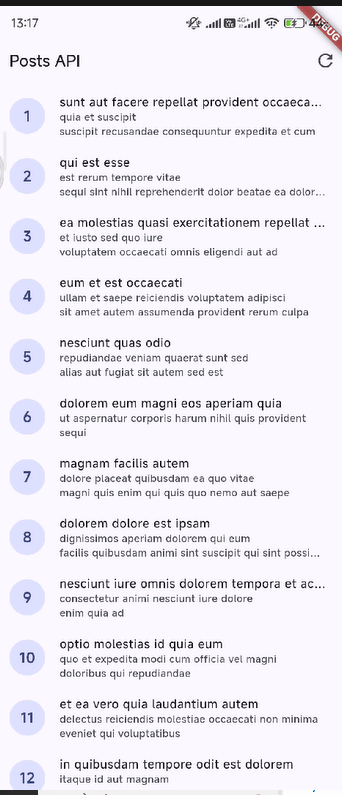
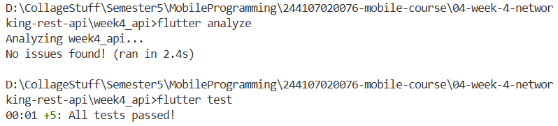

# week4_api

A new Flutter project.

## Getting Started

This project is a starting point for a Flutter application.

A few resources to get you started if this is your first Flutter project:

- [Learn Flutter](https://docs.flutter.dev/get-started/learn-flutter)
- [Write your first Flutter app](https://docs.flutter.dev/get-started/codelab)
- [Flutter learning resources](https://docs.flutter.dev/reference/learning-resources)

For help getting started with Flutter development, view the
[online documentation](https://docs.flutter.dev/), which offers tutorials,
samples, guidance on mobile development, and a full API reference.

1. Why is the UI forbidden from calling Dio directly? What breaks if this rule is violated?
Calling Dio directly from the UI violates separation of concerns and breaks dependency injection, making offline repository mocking impossible in tests while scattering network configuration and lifecycle-unsafe async calls across widgets.   
2. When is client-side pagination enough, and when must you rely on server pagination (_page/_limit)?
Client-side pagination suffices for small, bounded datasets that load cheaply in a single payload, whereas server pagination (_page/_limit) is essential for large, dynamic, or unbounded collections that would otherwise exhaust device memory and bandwidth.
3. How do repository exceptions become AsyncError without try/catch in every widget? When is explicit try/catch still needed?
Riverpod automatically catches exceptions thrown inside AsyncNotifier.build() and transitions the state into AsyncError, though explicit try/catch blocks remain necessary inside imperative methods like refresh() or pagination handlers where Riverpod does not automatically guard execution.
4. Which part of the AI output did you fix, and why?
I disabled Riverpod 3’s default retry behavior on postListProvider, implemented the missing readPostsOnce and error-catching readPostsErrorOnce test helpers in providers.dart, and isolated widget_test.dart with a ProviderScope override so all unit and widget tests terminate cleanly without hanging or making live HTTP requests.